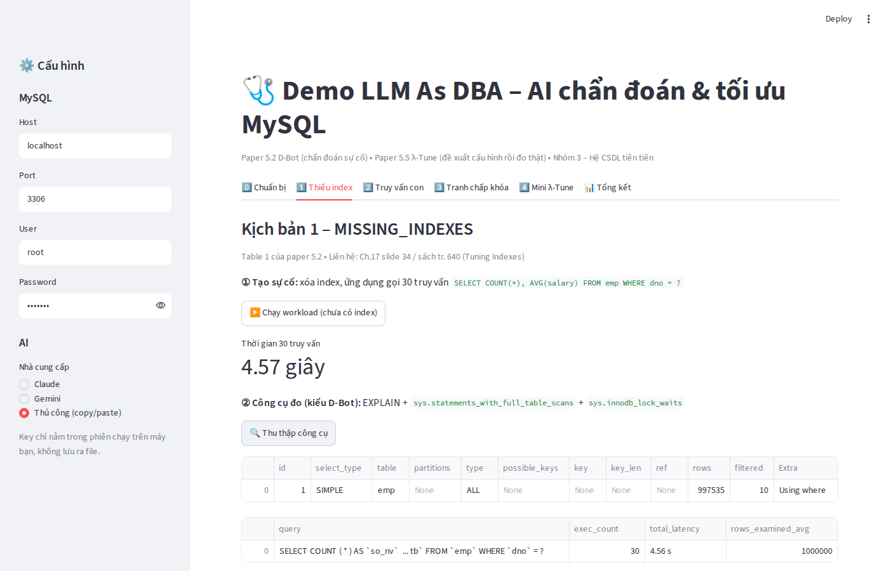

# Hướng dẫn chạy demo "LLM As DBA" (Nhóm 3)

Demo là **một trang web chạy trên máy của bạn** (viết bằng Python + Streamlit). Trang web này:
1. Kết nối vào **MySQL** trên máy bạn và tạo một database tên `demo_dbot` với 1 triệu nhân viên.
2. Cố tình **gây ra 3 sự cố** giống Table 1 của paper 5.2: thiếu index, truy vấn con tương quan, tranh chấp khóa.
3. **Hỏi AI (Claude hoặc Gemini) theo 2 cách**:
   - Prompt A ("AI trơn"): chỉ kể triệu chứng.
   - Prompt B ("AI kiểu D-Bot"): kèm thẻ kinh nghiệm và kết quả đo thật (EXPLAIN, view `sys`).
4. **Sửa sự cố**, đo lại và vẽ biểu đồ trước/sau.
5. **Mini λ-Tune** (paper 5.5): AI đề xuất cấu hình, app chạy thử thật từng cấu hình rồi chọn cấu hình nhanh nhất.
6. **TPC-H** (tab 5): làm lại kịch bản D-Bot và mini λ-Tune trên **TPC-H** – benchmark mà paper 5.5 dùng.
7. **🤖 D-Bot tự chủ** (tab 6): đủ 9 bước như D-Bot thật – ① giám sát realtime (performance_schema, chờ khóa) tự phát hiện → ② tự tạo incident (mã, mức P1/P2) → ③ 3 agent như paper – Chief DBA, CPU and Workload DBA, Memory and Database DBA – tự chẩn đoán (tự đọc kinh nghiệm BM25, tự chọn công cụ, quay lui; tùy chọn thêm vai Phản biện) → ④ tóm tắt + bằng chứng → ⑤⑥ DBA hỏi thêm qua chat, AI tự gọi thêm công cụ → ⑦ đề xuất lệnh → ⑧ DBA duyệt/từ chối → ⑨ AI tự kiểm tra lại và đóng incident.

---

## PHẦN 1 – Cài đặt (làm 1 lần, khoảng 20 phút)

### Bước 1. Kiểm tra MySQL
- Mở **MySQL Workbench**, đăng nhập bằng user `root` (chính là bản bạn dùng cho các bài tập trước).
- Chạy `SELECT VERSION();` → kết quả phải bắt đầu bằng **8.**
- Nếu chưa có MySQL: tải **MySQL Installer** (Community) → chọn *Server + Workbench* → đặt mật khẩu root và **ghi nhớ** mật khẩu này.

### Bước 2. Kiểm tra / cài Python
- Mở **Command Prompt** (bấm phím Windows, gõ `cmd`) và gõ: `python --version`
- Nếu thấy `Python 3.9` trở lên là được.
- Nếu báo lỗi hoặc mở Microsoft Store: tải Python tại python.org. Khi cài, **tích ô "Add python.exe to PATH"**. Cài xong, mở lại cmd và thử lại lệnh trên.

### Bước 3. Cài thư viện cho demo
- Mở thư mục `Demo_LLMasDBA\app`.
- **Bấm đúp `1_cai_dat.bat`** và chờ đến khi hiện chữ "Xong!".

### Bước 4. Lấy API key (chọn 1 trong 2)
- **Gemini** (có gói miễn phí): vào trang **Google AI Studio** → *Get API key* → *Create API key* → copy chuỗi bắt đầu bằng `AIza...`
- **Claude**: vào **Anthropic Console** → *API Keys* → *Create Key* → copy chuỗi bắt đầu bằng `sk-ant-...` (cần nạp tiền vào tài khoản).
- Nếu không có key, chọn chế độ **"Thủ công (copy/paste)"**: app hiện prompt, bạn copy sang ChatGPT web, rồi dán câu trả lời ngược lại vào app.

> ⚠️ Không gửi API key lên nhóm chat và không đưa key vào slide.

---

## PHẦN 2 – Chạy thử trước buổi báo cáo

1. **Bấm đúp `2_chay_demo.bat`** → trình duyệt tự mở `http://localhost:8501`.
   - Không được đóng cửa sổ đen (cmd), vì app đang chạy trong đó.
2. Ở **thanh bên trái**:
   - Nhập **Password** của root.
   - Chọn **Claude** hoặc **Gemini**, rồi dán API key.
   - Ô **Model** để mặc định. Nếu app báo lỗi "model not found", đổi sang tên model mới hơn trong trang tài liệu của hãng.
3. Tab **0️⃣ Chuẩn bị**:
   - Bấm **Kiểm tra kết nối**.
   - Bấm **Tạo dữ liệu**, chờ khoảng 10–60 giây.
   - Tab **5️⃣ TPC-H**: chọn SF **0.05** → bấm **Tạo TPC-H** (khoảng 10–30 giây). Cách khác: bấm đúp `3_tao_TPCH.bat`.
4. Chạy thử lần lượt các tab 1 → 4 (cách làm ở Phần 3) và ghi lại thời gian.
   - Nếu **tab 2** chạy quá lâu (> 30 giây): quay lại tab 0, giảm "Số dòng emp_small" xuống 3000 rồi tạo lại dữ liệu.
   - Nếu tab 2 chạy quá nhanh (< 3 giây): tăng lên 8000.
5. Ở tab **📊 Tổng kết**, bấm **Tải toàn bộ câu trả lời AI** để lưu kết quả làm bằng chứng cho mục "So sánh với ChatGPT" trong báo cáo.
   - Mỗi prompt nên bấm hỏi **3 lần** và ghi lại cả 3 câu trả lời.

> 💡 Nên quay video màn hình lần chạy thử thành công. Nếu hôm báo cáo mạng hoặc máy gặp sự cố thì phát video thay thế.

---

## PHẦN 3 – Kịch bản bấm khi thuyết trình (slide 14–15, khoảng 5 phút)

| Tab | Bấm theo thứ tự | Nói gì |
|---|---|---|
| **1️⃣ Thiếu index** | ▶️ Chạy workload → 🔍 Thu thập công cụ → 🤖 Hỏi AI A → 🤖 Hỏi AI B → 🛠️ Tạo index & chạy lại | "EXPLAIN cho thấy type = ALL, quét 1 triệu dòng. Prompt B có thẻ kinh nghiệm nên AI chỉ ra đúng cột dno và đưa lệnh CREATE INDEX (Ch.17 slide 34, tr. 640)." |
| **2️⃣ Truy vấn con** | ▶️ Chạy truy vấn chậm → hỏi AI A, B → 🛠️ Chạy bản viết lại | "Truy vấn con chạy lại cho từng dòng (DEPENDENT SUBQUERY). Viết lại theo kiểu unnesting (Ch.19 slide 17, tr. 704) nhanh hơn hàng trăm lần mà kết quả vẫn giống hệt." |
| **3️⃣ Tranh chấp khóa** | ① Phiên A → ② Phiên B → 🔍 ③ Thu thập công cụ → hỏi AI A, B → 🛠️ ④ ROLLBACK | "A chưa commit nên vẫn giữ khóa ghi. Theo Strict 2PL (Ch.21 slide 13), B phải chờ. Công cụ chỉ ra đúng phiên đang chặn." |
| **4️⃣ Mini λ-Tune** | 🤖 Xin AI 3 cấu hình → ⏱️ Chạy thật & đo | "Có cấu hình nghe hợp lý (index trên dno) nhưng lại chậm gấp nhiều lần. Vì vậy λ-Tune không tin lời AI mà phải đo thật." |
| **5️⃣ TPC-H** | ① Chạy Q17 → hỏi AI A, B → 🛠️ Chạy bản viết lại → 🛠️ Tạo index & chạy lại → ⏱️ Chạy thật & đo tất cả cấu hình | "Q17 của TPC-H có sẵn truy vấn con tương quan: ≈10 s → viết lại 0,4 s, hoặc index l_partkey 0,013 s. Trong mini λ-Tune, chỉ index trên khóa JOIN mới nhanh hơn ~30 lần." |
| **🤖 D-Bot tự chủ** | A. chọn hãng + model cho 3 agent (Chief / CPU and Workload / Memory and Database), 🧪 Thử kết nối → B. ▶️ Bật giám sát → C. bấm 1 ca sự cố → chờ incident tự xuất hiện và tự chẩn đoán → hỏi 1 câu ở ô chat → ✅ Duyệt & chạy → xem ⑨ AI tự kiểm tra và đóng incident | "Không ai báo cho D-Bot. Giám sát tự phát hiện, tự tạo incident, 3 agent như paper tự hội chẩn; DBA hỏi thêm, duyệt; D-Bot tự kiểm tra lại rồi đóng." |
| **📊 Tổng kết** | Xem bảng chấm | "Prompt B đúng nguyên nhân và có lệnh sửa cụ thể nhiều hơn Prompt A." |

Ghi chú:
- Bước ② (phiên B) ở tab 3 sẽ báo lỗi "Lock wait timeout" nếu bạn chờ quá 20 giây mới bấm ROLLBACK. Lỗi này **cũng là kết quả đúng**, có thể dùng để giải thích.
- Ở tab 4, app **chặn** mọi lệnh AI đề xuất không nằm trong danh sách cho phép (ví dụ DROP TABLE). Đây chính là ý "DBA phải phê duyệt" mà nhóm nêu ở slide hạn chế.

---

## PHẦN 4 – Xử lý lỗi thường gặp

| Lỗi | Cách sửa |
|---|---|
| `'python' is not recognized` | Cài lại Python và tích "Add to PATH", hoặc thay `python` bằng `py` trong 2 file .bat |
| `Access denied for user 'root'` | Sai mật khẩu root ở thanh bên trái |
| `Can't connect to MySQL server` | MySQL chưa chạy: mở *Services* → khởi động **MySQL80** |
| `Claude API lỗi 401` / `Gemini API lỗi 400/403` | Sai API key, hoặc key chưa được kích hoạt / chưa nạp tiền |
| `model not found` (404) | Đổi tên model ở thanh bên trái |
| `Access denied; you need SUPER or SYSTEM_VARIABLES_ADMIN` | Tab 4 cần quyền SET GLOBAL → đăng nhập bằng user **root** |
| `Chua cai tpchgen-cli` | Chạy lại `1_cai_dat.bat` (đã thêm tpchgen-cli vào requirements.txt) |
| `Loading local data is disabled` khi tạo TPC-H | App tự bật `local_infile`; nếu vẫn lỗi, chạy trong Workbench: `SET GLOBAL local_infile = 1;` |
| Q17 chạy quá lâu (> 30 giây) | Tạo lại TPC-H với SF 0.02 |
| Tab 6 báo lỗi 429 / quá tải | Gói miễn phí giới hạn số lần gọi/phút → chia các vai cho nhiều hãng (Gemini, Groq, GitHub Models, Claude Code), hoặc chờ 1 phút |
| Claude Code (gói Pro) báo "Chua cai Claude Code" | Cài Node.js → `npm install -g @anthropic-ai/claude-code` → gõ `claude` để đăng nhập tài khoản Pro. Không đặt biến ANTHROPIC_API_KEY |
| Lấy key miễn phí | Groq: console.groq.com • GitHub Models: GitHub → Settings → Developer settings → Personal access token • OpenRouter: openrouter.ai/keys • Cerebras: cloud.cerebras.ai • Mistral: console.mistral.ai |
| Tab 6 ca 3 báo phiên B "Lock wait timeout" | Quá 10 phút chưa xử lý → bấm 🔓 Nhả khóa rồi bấm lại Ca 3 |
| Tab 2 chạy quá lâu | Giảm số dòng emp_small ở tab 0 rồi tạo lại dữ liệu |

Sau buổi demo, có thể xóa database bằng file `..\99_cleanup.sql` trong Workbench.

## Các file
- `app.py` – giao diện (các tab, nút bấm, biểu đồ)
- `demo_core.py` – logic: kết nối MySQL, 3 kịch bản, thẻ kinh nghiệm, prompt A/B, gọi API Claude/Gemini, mini λ-Tune
- `monitor_core.py` – giám sát realtime, vòng đời incident, chạy nền (chẩn đoán, chat, duyệt, kiểm tra lại)
- `agent_core.py` – D-Bot tự chủ (nhiều hãng AI: Gemini, Claude API, Claude Code gói Pro, Groq, OpenRouter, GitHub Models, Cerebras, Mistral, Ollama): kho 10 thẻ kinh nghiệm + BM25, vòng lặp agent (Chief DBA → CPU and Workload DBA → Memory and Database DBA, tùy chọn Phản biện), 10 công cụ chỉ đọc gồm workload_status và memory_status, duyệt & chạy lệnh sửa
- `tpch_core.py` – TPC-H: sinh dữ liệu (tpchgen-cli) + nạp MySQL, kịch bản Q17, mini λ-Tune 5 truy vấn TPC-H. Chạy riêng: `python tpch_core.py --password <mk> --test`
- `requirements.txt`, `1_cai_dat.bat`, `2_chay_demo.bat`, `3_tao_TPCH.bat`
- `..\06_tpch_q17.sql` – Q17 chậm / viết lại / thêm index để chạy tay trong Workbench

### Số liệu đo thử TPC-H (SF 0.05, MySQL 8.0.46, 2 CPU)
| | Thời gian |
|---|---|
| Nạp dữ liệu (8 bảng, lineitem 299.814 dòng) | ≈ 10 giây |
| Q17 gốc (DEPENDENT SUBQUERY) | 9,3 – 10,3 s |
| Q17 viết lại (unnesting) | 0,40 – 0,45 s |
| Q17 + index `lineitem(l_partkey)` | 0,013 s |
| Mini λ-Tune: C0 mặc định / C1 buffer / C2 index ngày / C3 index khóa JOIN | ≈10 s / ≈10 s / ≈9,5 s / 0,3 s |
